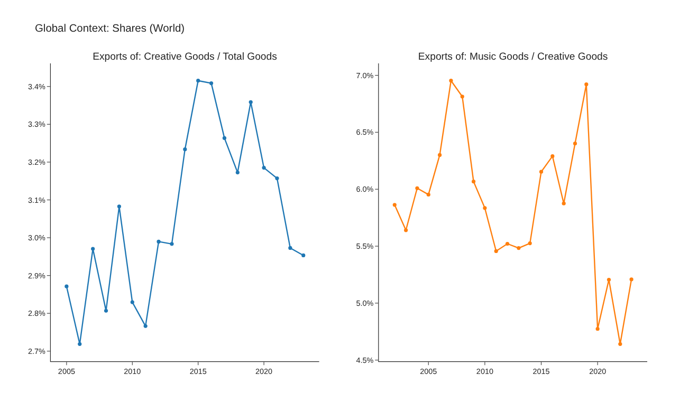
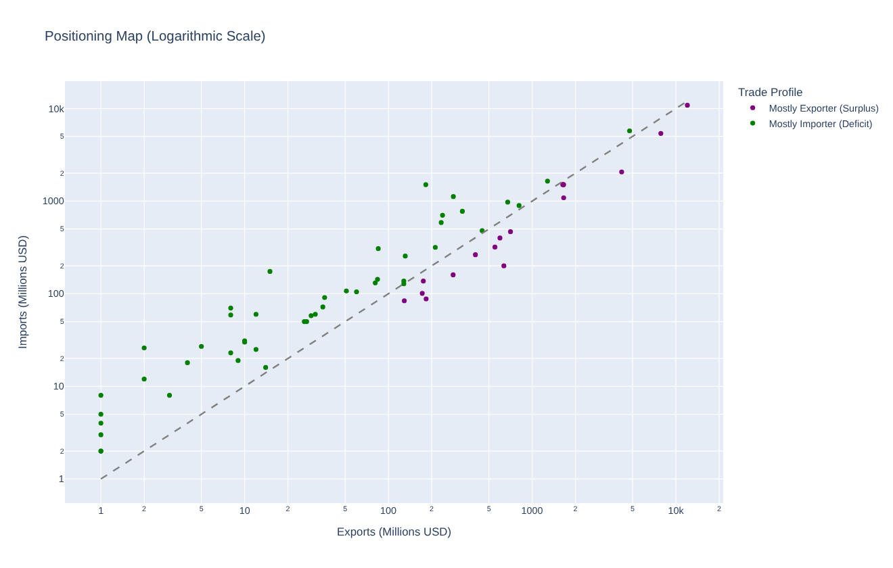
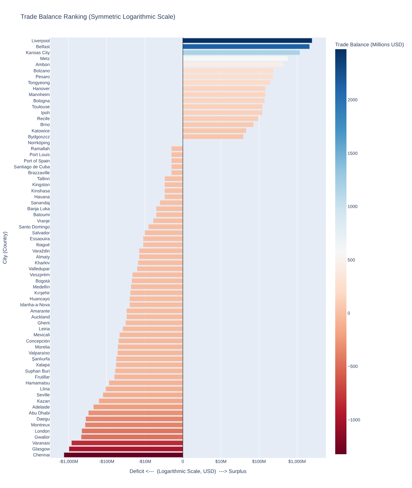

# UNESCO "Cities of Music" vs. Music Trade (2006-2023)

An advanced-visualization project in Python that puts the UNESCO Creative Cities Network's **"Cities of Music"** designations next to each country's **music goods exports and imports**, to see whether the titles follow (or change) trade trends and where in the world the titles are concentrated.

Everything lives in one notebook, [`cities_of_music_analysis.ipynb`](cities_of_music_analysis.ipynb), built with `pandas`, `numpy`, `plotly` and `geopy`. It was written as coursework for the *Advanced Visualization (Python)* module of a Master's in Data Science (UCM) by [@jasolni](https://github.com/jasolni).

## Questions the notebook tries to answer

1. How big is the creative goods market within total global goods trade, and how big is music within creative goods?
2. Do a country's music exports/imports change after one of its cities is designated, or are designations rather the result of trends that were already under way?
3. Is there a spatial pattern in where the titles are awarded (a region or continent with more cities)?
4. Is exporting or importing music goods more relevant to the countries that host these "music hubs"?

## Main findings

- **Music is a small, steady slice of trade.** Creative goods are about 3 % of world goods exports (2.7 %-3.4 % depending on the year); music accounts for roughly 6 % of creative goods exports (4.6 %-7.0 %).
- **Traditional creative segments barely grow.** Between 2008 and 2023, world exports of books and publishing fell by about a third, "music, performing and visual arts" grew only 18 %, while jewellery grew roughly 2.5 times and the broad crafts and design category kept expanding.
- **No generalizable "designation effect".** Country by country, music exports/imports do not systematically change after a designation; sometimes the title arrives in a growing market, sometimes in a declining one.
- **Most host countries are net importers.** Of the 70 cities with trade data for their designation year, 52 sit in countries that import more music goods than they export, 17 in countries that export more (e.g. Recife, Brno, Liverpool, Belfast, Kansas City) and one (Norrköping) is balanced. Seven cities report zero music exports that year.
- **Uneven geography.** Africa has only six Cities of Music (Brazzaville, Kinshasa, Praia, Essaouira, Port Louis, Bissau), while Italy alone has three; China has none and Japan one (Hamamatsu). Trade values say more about the size of national economies than about musical life, which suggests the programme should be assessed with social, cultural and qualitative indicators rather than trade alone.

## Charts in the notebook

| # | Chart | Type |
|---|-------|------|
| 2 | Share of creative goods in total goods, and of music in creative goods (World) | Line subplots |
| 2a | Exports by type of creative product, 2002-2023, with and without the "crafts and design" category | Animated bar chart |
| 3 | Music exports and imports of every country with a City of Music, with designation years marked | Interactive multi-line chart |
| 4 | One chart per country with a dashed vertical line in each designation year | Line charts |
| 5 / 5a | World map of designated cities, countries shaded, hover shows year and music trade that year; corrected version using ISO codes and a GeoJSON so countries such as Palestine render | Choropleth + scatter geo |
| 6 | Positioning map of exports vs. imports (log-log) and diverging trade-balance ranking | Scatter + bar |
| 6a | Same ranking on a **symmetric log (SYMLOG) scale** so extreme values do not hide the middle | Bar |

Static previews of the non-map charts (the maps need an internet connection to geocode the cities, so they are only produced when you run the notebook):





## Data

All files are in [`data/`](data/).

| File | Content | Source |
|------|---------|--------|
| `cities_of_music_2006-2023.csv` | 75 cities in 51 countries with their designation year (`City, Country, Year`) | [UNESCO Creative Cities Network - Cities of Music](https://citiesofmusic.net/music-cities/) |
| `goods_exps_*`, `goods_imps_*` | Total world and country goods exports/imports | [UNCTADstat data centre](https://unctadstat.unctad.org/datacentre/) |
| `tot_exp_*`, `tot_imp_*` | Creative goods exports/imports by economy | [UNCTAD creative economy statistics](https://unctad.org/creative-economy-programme/statistics) |
| `mus_exp_*`, `mus_imp_*` | Music exports/imports by economy. In the UNCTAD classification this is the product group *"Music, performing and visual arts"* | same |
| `products_*` | Creative goods exports by product group | same |

Trade files have the columns `Economy_Label, Year, US_at_current_prices_in_millions_Value` (the products file also has `Product_Label`); values are **millions of current US dollars**. The files were downloaded in February 2026.

Caveats:

- Note that "music" here means the whole product group *music, performing and visual arts*, and the figures include services and rights (streaming, concerts...), not only physical goods. They say more about market size than about music being physically traded.
- UNCTAD data end in 2023; the programme has kept designating cities since. Some economies have no or incomplete data (e.g. Cabo Verde, Guinea-Bissau, Venezuela, Vietnam, Russia): 5 of the 75 cities (Praia, Bissau, Caracas, Da Lat, Veliky Novgorod) are left out of the trade comparisons.
- Country names differ between UNESCO and UNCTAD; the notebook reconciles them with a correction dictionary and a separate ISO mapping for the maps.
- The data belong to their original publishers; check UNESCO's and UNCTAD's terms of use before redistributing or reusing them.

## Running it

```bash
git clone https://github.com/jasolni/cities-of-music-viz.git
cd cities-of-music-viz
python -m venv .venv && source .venv/bin/activate
pip install -r requirements.txt
jupyter lab cities_of_music_analysis.ipynb
```

Run all cells in order. **An internet connection is required** for two steps: city coordinates are looked up with the free OpenStreetMap *Nominatim* service through `geopy` (limited to one request per second, so geocoding takes a couple of minutes and is repeated in each map cell), and the corrected map downloads a public GeoJSON of country borders from `raw.githubusercontent.com`. Outputs are cleared in the repository, so every chart is generated when you run it.

## Method notes

- **Cleaning:** names are stripped, normalized and aligned across the UNESCO and UNCTAD files (`country_fixes`), and the function `clean_df` applies this to every trade table.
- **Designation events:** designations are grouped per country and year, so a country with two titles in one year gets one combined label.
- **Choropleth fix:** Plotly's built-in country matching does not recognise some territories, so the second map uses ISO-3 codes with an explicit GeoJSON and masks countries without titles in grey.
- **SYMLOG scale:** `sign(x) * log10(1 + |x|)`, with tick labels rewritten as real dollar amounts (-$1,000M ... $1,000M).
- **Zeros on log axes:** log axes cannot show zero, so cities with zero exports are absent from the log-log scatter (but present in the rankings).

## Repository layout

```
cities_of_music_analysis.ipynb   the analysis (English, outputs cleared)
data/                            input CSV files
images/                          static previews used in this README
requirements.txt
```
